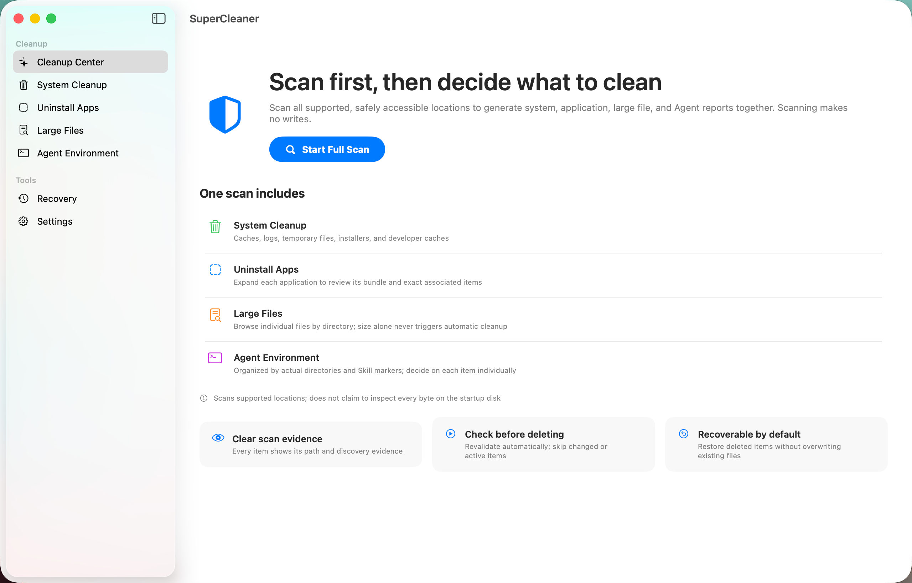

# SuperCleaner

**The first known macOS system cleaner to include dedicated AI agent workspace cleanup.** SuperCleaner helps you reclaim disk space while keeping cleanup visible, reviewable, and recoverable.

## Features

- Scan caches, logs, temporary files, installers, developer artifacts, historical uninstall remnants, and large files.
- Review evidence and safety status before cleanup; app and large-file results require explicit selection; Agent capability coverage can preselect eligible Skills and MCP configurations for your confirmation.
- Plan application uninstallations with related files and installation ownership checks.
- Find project artifacts such as `node_modules`, `target`, `.build`, `build`, and `dist`, while protecting active projects and tracked content.
- Discover Codex, Claude, Cursor, Trae, and other AI agent environments. Inspect Skills, MCP configurations, sessions, caches, and worktrees with protections for sensitive data.
- Quarantine eligible items for recovery, keep an operation history, and protect paths you choose.

## Get started

SuperCleaner requires macOS 13 or later and Swift 6. Clone the repository and build the app:

```bash
git clone https://github.com/projectersMan/supercleaner.git
cd supercleaner
./Scripts/build-app.sh
open build/SuperCleaner.app
```

The Cleanup Center keeps its introduction, four scan scopes, and three safety cards in place before, during, and after scanning. Click any scope row to open its page, including while waiting or scanning. Each active module page has its own Cancel Scan button; Resume Scan reruns only that canceled module and keeps results from the others. This is a module restart, not a filesystem traversal checkpoint. The sidebar and titlebar use the native unified toolbar layout.

Agent environment scans use the bundled Google EmbeddingGemma 2 model to analyze directional capability containment: Skill against other Skills, and MCP against other MCP configurations. Skills and MCP use the same default 85% threshold, configurable in Settings. When the union of capabilities provided by other items of the same type reaches that threshold, eligible items are preselected. Existing file protections remain in force, covering items are retained, and deletion still requires your manual confirmation.

The Agent page keeps the original inventory, paths, checkboxes, grouping, and filters. Each row ranks up to three other items by how much of the current item they cover, with names and paths to distinguish copies. Hover over an individual Top 3 item to see its complete path, including the parts truncated in the list. The combined coverage summary is omitted from the interface. The internal calculation uses all other items, not just the displayed three: 86 distinct descriptions covered out of 100 means 86%, which meets the default 85% threshold. Overlapping coverage is counted once. All extracted capability descriptions are retained; reference lists are excluded and long descriptions are split without a 64-item sampling cap. These are estimates from scanned descriptions, not a count of verified runtime functions. After upgrading from the old analysis policy, use Recalculate all containment to replace old scores.

Regular scans reuse known items and relationships by stable identity without checking for content changes. Only new items are embedded and paired with known items of the same type. Use **Settings → Agent capability analysis → Recalculate all containment** to rescan Agent resources and rebuild all current data, including changed items. Changing the threshold reuses cached results.

The app retains its original macOS 13 requirement. Only Agent capability analysis requires macOS 14 or later on Apple Silicon; its bundled inference process loads the model separately from the app. The approximately 310 MB Q8 model is bundled under Apache License 2.0, so the first scan needs no model download. The local containment index is `~/Library/Application Support/SuperCleaner/agent-containment-index.plist`. MCP configurations use safe server names and any existing local purpose descriptions as capability clues; analysis does not connect to MCP services or read credentials, environment variables, command arguments, or headers. Names alone provide limited capability information. Analysis and preselection follow the same calculation for both types and never delete files automatically.

To run the local build verification:

```bash
./Scripts/verify-app.sh
```

Local builds require a fixed signing certificate and private key in the login keychain. Select its SHA-1 with `SUPERCLEANER_SIGN_IDENTITY`, or pin it in `~/Library/Application Support/SuperCleaner/Signing/identity.sha1`. Builds fail if that identity is unavailable instead of silently switching to ad-hoc signing. A local self-signed build can be installed manually on another Mac, subject to that Mac's opening and privacy authorization prompts; it is not an Apple-notarized release. Each Mac grants its own access permissions.

## How to use

Clicking the SuperCleaner Dock icon reopens the main window after it was closed with the red close button, and restores it if it was minimized.

The app list initially shows Uninstallable. Running and system apps remain in All and Running/System protected scopes. Search follows the selected scope, and an empty filtered result explains how to search the full list. App names omit the duplicate green Running badge; the right-side status still explains running restrictions. The protected scope and row badge use Protected.

Application icons use native macOS artwork, resolved through the existing cache for the first rendered row without a placeholder-to-icon task. Embedded helpers with only a generic icon inherit the nearest enclosing application’s icon. Local updates replace `/Applications/SuperCleaner.app`; open that installed copy after an update.

Cleanup Center keeps four clickable scan rows with right-aligned status and the same hover highlight as the application list. Cancel and Resume remain inside each module page. Finished scans share the green checkmark **Scan complete** badge, while their original coverage and cleanup protections are retained. The three capability cards share the height of the tallest content and align at the top.

The Agent page shows its analysis status directly above the inventory. Each analyzed item shows up to three covering peers and their paths; the combined summary is omitted from the interface. If an upgrade changes the analysis rules, the previous index is not reused: the page explains that **Settings → Recalculate all containment** is required. Eligible default selections appear after analysis finishes; no selections can also be a valid result when coverage is below your threshold or existing file protections apply.

Full scans start directly without a permission setup window. On first launch, an app without verified Full Disk Access shows one short reminder with a System Settings link; an already configured app skips it. The reminder is remembered across restarts and does not represent an authorization grant.

App scans quietly skip locations that deny read access, without reporting those expected skips as a regional permission warning. Results cover accessible locations; skipped content remains protected from cleanup. The four scan modules and application refresh do not stop at a fixed entry count. Depth, time, and content-size limits still apply, and scans can be canceled. Other failures remain visible. System Settings links remain in the app’s Settings page.

Permissions and the optional helper remain in Settings. The first scan preflights known locations once if Full Disk Access is not available; later scans do not repeat this setup. macOS still enforces access and may request its own confirmation when needed.

The Uninstall Apps search and filter bar uses the same compact spacing and vertical placement as Large Files, while retaining scope, sorting, application counts, and refresh controls. Completed application analyses omit the repetitive success badge; protection and incomplete-analysis indicators remain visible.



1. Open SuperCleaner and start a full scan from **Overview**. Grant macOS permissions when prompted for protected locations.
2. Review findings in **Cleanup Center**, **Applications**, **Large Files**, **Agent Environment**, or **Project Artifacts**. Historical uninstall remnants appear in **Cleanup Center**: orphaned caches and verified empty residual directories with complete Bundle ID and application-inventory evidence can be suggested for cleanup, while non-empty application-support data stays in suggested retention for review. Select an item to inspect its path, evidence, and safety status.
3. Choose what to include. Eligible system cleanup items can be preselected; application, large-file, and agent workspace findings require your explicit selection. Blocked items cannot be selected.
4. Review the cleanup plan and confirm. SuperCleaner checks selected items again before acting. By default, items move to macOS Trash after safety checks and record saving. Choose a retention period in **Settings** to keep items in Recovery first.
5. Open **Recovery** to review completed operations and restore retained items while they remain available. Recovery and Trash contents are excluded from large-file results and their totals.

To uninstall an app, open **Applications**, select it, review its related items, and confirm the plan. Apps managed by Homebrew, Steam, or another installer should be removed through that source. Add paths to the protection list in **Settings** to exclude them from cleanup plans.

## Privacy and safety

- Scanning is read-only. Cleanup requires a reviewed plan and explicit confirmation.
- Selected items are revalidated before execution; eligible items go to quarantine for recovery.
- Agent summaries do not collect sensitive MCP values such as command arguments, environment variables, headers, or tokens.
- Diagnostic reporting is off by default.
- The optional privileged Helper requires explicit setup, system approval, and temporary session authorization. If it is unavailable, SuperCleaner does not silently escalate privileges.
- Licensed under **GNU GPL v3.0 only**. See [LICENSE](LICENSE) for the complete terms.

Agent 默认选择优先保留用户主目录 `.agents` 中的共享源，独立重复副本沿用包含阈值；`.agents` 不代表所有 Agent 自动加载。Skill目录、manifest、MCP配置或其父目录为软链接时，不进入清单、Top 3、覆盖分析或预选；断链也排除。可独立发现的真实目标仍保留，不修改链接或目标。主目录 `.cache` 中通过清理资格检查的 Skill/MCP 无需重叠即可预选，用户明确保留优先；扫描不会自动删除，仍需确认。覆盖排名展示前3名；当前Skill/MCP与覆盖对象分左右两栏，标签、路径与大小紧随左栏描述，不显示Combined Coverage。预选仍累计全部来源。

应用卸载筛选栏与大文件页保持相同字号及上下间距；搜索框固定260 pt，四项筛选固定等分，切换范围时不会挤动控件；窄窗口自动分为两行。移除Refresh Apps按钮。

清理中心全扫描按钮右侧显示本轮扫描用时（时:分:秒），从点击全扫描实际启动本轮任务计时，包含必要预访问、四模块和Agent分析；全部结束后保留最终用时，重新全扫描清零。取消或失败后无任务时冻结，继续被取消模块则从本轮原始起点继续计时。

点击全扫描直接开始，不再打开大权限配置窗口。首次启动且尚未验证完全磁盘访问时，只显示一次简短提醒；已有磁盘访问的用户不显示，提醒记录跨重启保留。设置页继续提供FDA、App管理与可选Helper的系统入口。首次扫描未确认FDA时会在并行扫描前进行一次只读预访问，之后不重复；系统仍对实际访问独立检查。Top 3中的其他Skill位于各平台分组，软链接不作为另一份Skill。

权限状态在首次提醒判定、每次扫描开始和进入/返回设置页时刷新；提醒记录不代替授权结果。依次检查用户和系统专用保护目录，任一个可访问即可确认探测可用；拒绝、缺失和一般错误保持原有分类。App管理显示“执行卸载时由系统确认”，扫描中的拒绝和系统保护仍静默跳过。

Agent 页的 Skill 与 MCP 条目使用与大文件相同的细横线分隔；高亮、鼠标命中和横线使用同一内容边界，避免List行内边距造成错位。分组、两栏信息、悬停颜色和勾选方式保持一致。

Skill 与 MCP 使用相同的覆盖信息右栏：固定360 pt，标题、名称与路径左对齐，百分比独立列对齐；左栏允许随窗口收缩，切换类型不改变右栏起点。MCP每行不再重复显示服务器数量，顶部配置和服务器定义总数保留。权限页的Available仅表示FDA只读探测可用；App管理显示卸载时由系统确认，不以未显示Available推断未授权。
