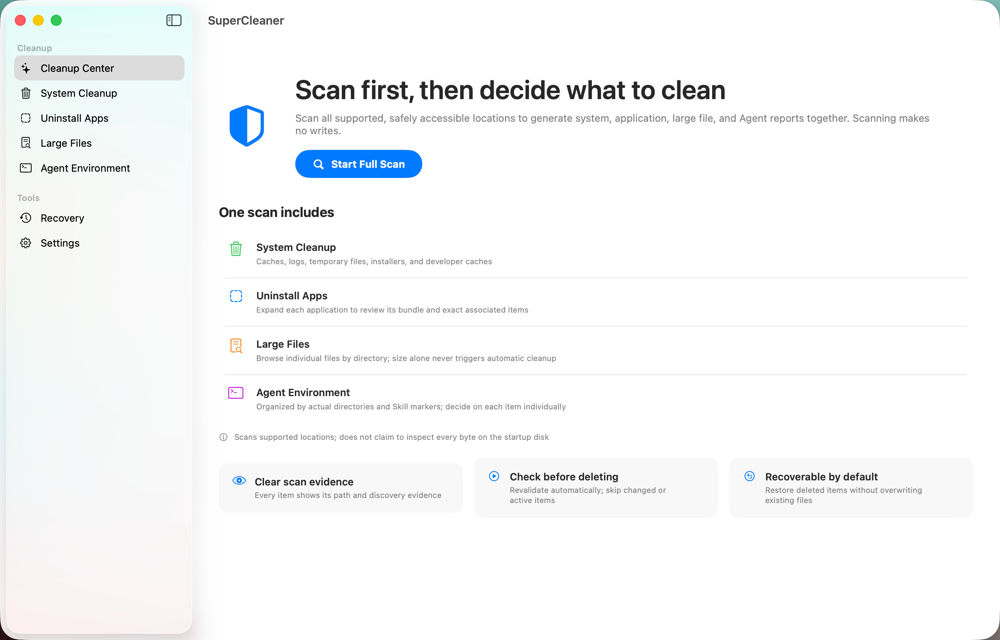

# SuperCleaner

**The first known macOS system cleaner to include dedicated AI agent workspace cleanup.** SuperCleaner helps you reclaim disk space while keeping cleanup visible, reviewable, and recoverable.

## Features

- Scan caches, logs, temporary files, installers, developer artifacts, historical uninstall remnants, and large files.
- Review evidence and safety status before cleanup; app, large-file, and AI agent results require explicit selection.
- Plan application uninstallations with related files and installation ownership checks.
- Find project artifacts such as `node_modules`, `target`, `.build`, `build`, and `dist`, while protecting active projects and tracked content.
- Discover Codex, Claude, Cursor, Trae, and other AI agent environments. Inspect Skills, MCP configurations, sessions, caches, and worktrees with protections for sensitive data.
- Quarantine eligible items for recovery, keep an operation history, and protect paths you choose.

## Get started

SuperCleaner requires macOS 13 or later and Swift 6. Clone the repository and build the app:

```bash
git clone https://github.com/projectersMan/supercleaner.git
cd supercleaner
./Scripts/build-app.sh
open build/SuperCleaner.app
```

To run the local build verification:

```bash
./Scripts/verify-app.sh
```

Local builds may use ad-hoc signing and are intended for development. They are not notarized public releases.

## How to use



1. Open SuperCleaner and start a full scan from **Overview**. Grant macOS permissions when prompted for protected locations.
2. Review findings in **Cleanup Center**, **Applications**, **Large Files**, **Agent Environment**, or **Project Artifacts**. Historical uninstall remnants appear in **Cleanup Center**: orphaned caches and verified empty residual directories with complete Bundle ID and application-inventory evidence can be suggested for cleanup, while non-empty application-support data stays in suggested retention for review. Select an item to inspect its path, evidence, and safety status.
3. Choose what to include. Eligible system cleanup items can be preselected; application, large-file, and agent workspace findings require your explicit selection. Blocked items cannot be selected.
4. Review the cleanup plan and confirm. SuperCleaner checks selected items again before acting and moves eligible items into quarantine.
5. Open **History** to review completed operations and restore quarantined items while they remain available.

To uninstall an app, open **Applications**, select it, review its related items, and confirm the plan. Apps managed by Homebrew, Steam, or another installer should be removed through that source. Add paths to the protection list in **Settings** to exclude them from cleanup plans.

## Privacy and safety

- Scanning is read-only. Cleanup requires a reviewed plan and explicit confirmation.
- Selected items are revalidated before execution; eligible items go to quarantine for recovery.
- Agent summaries do not collect sensitive MCP values such as command arguments, environment variables, headers, or tokens.
- Diagnostic reporting is off by default.
- The optional privileged Helper requires explicit setup, system approval, and temporary session authorization. If it is unavailable, SuperCleaner does not silently escalate privileges.
- Licensed under **GNU GPL v3.0 only**. See [LICENSE](LICENSE) for the complete terms.
